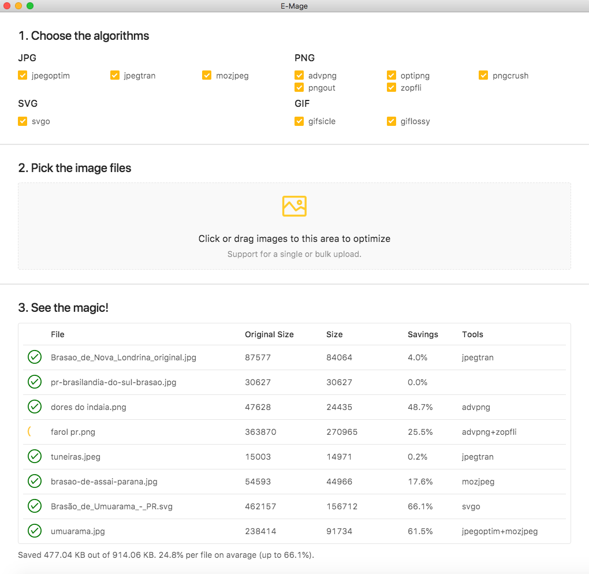

<p align="center">
  
  <br>
  <sub>From developers to developers: a cross-platform desktop tool for lossless image compression.</sub>
</p>

<p align="center">
  <b>E-Mage</b> (Electron + Image Compression + Magic) is a fast, cross-platform desktop application designed to losslessly reduce image file sizes without sacrificing a single pixel. Powered by <a href="https://github.com/imagemin/imagemin">imagemin</a> and 11 battle-tested compression engines, it streamlines batch optimization for developers, designers, and creators across Windows, macOS, and Linux.
</p>

<p align="center">
  <sub>Looking for the official website? Visit <a href="https://emage.js.org/"><b>emage.js.org</b></a>.</sub>
</p>

<p align="center">
  <a href="LICENSE"></a>
  <a href="https://github.com/douglasjunior/emage/releases"></a>
  <a href="https://github.com/douglasjunior/emage/stargazers"></a>
  
  
  
  <a href="https://github.com/douglasjunior/emage/pulls"></a>
</p>

<p align="center">
  <a href="#-quick-start"><b>Quick Start</b></a> ·
  <a href="#-why-e-mage">Why</a> ·
  <a href="#-screenshots">Screenshots</a> ·
  <a href="#-supported-formats--engines">Engines</a> ·
  <a href="#-downloads--installation">Download</a> ·
  <a href="#-usage-guide">Usage</a> ·
  <a href="#-development--building">Development</a> ·
  <a href="#-featured-on-the-web">Press & Mentions</a> ·
  <a href="#-contributing">Contributing</a> ·
  <a href="#-license">License</a>
</p>

---

## 🚀 Quick Start

Get started with **E-Mage** in 3 simple steps:

1. **Download** the latest pre-built executable for your system from [GitHub Releases](https://github.com/douglasjunior/emage/releases):
   - **Windows**: `E-Mage-Setup-*.exe`
   - **macOS**: `E-Mage-*.dmg`
   - **Linux**: `E-Mage-*.AppImage` or `E-Mage-*.deb`
2. **Launch the application** and drag & drop images (`.png`, `.jpg`, `.jpeg`, `.svg`, `.gif`) or whole directories into the drop window.
3. **Watch the savings roll in**: E-Mage runs your selected compression engines asynchronously, updates files losslessly in place, and displays instant before/after byte metrics.

```text
raw_photo.png       4.2 MB  ──►  [ optipng + zopfli ]  ──►  1.1 MB  (-74% saved · lossless)
vector_icon.svg     128 KB  ──►  [ svgo ]              ──►   42 KB  (-67% saved · lossless)
banner_scene.jpg    1.8 MB  ──►  [ mozjpeg ]           ──►  1.2 MB  (-33% saved · lossless)
```

---

## 💡 Why E-Mage?

- 💎 **100% Lossless Quality.** Zero compromise on visual clarity. Strips hidden EXIF metadata, superfluous comments, color profiles, and redundant table chunks while leaving 100% of pixel data intact.
- ⚡ **Multi-Engine Pipeline.** Combines 11 industry-standard compression engines (`mozjpeg`, `optipng`, `pngcrush`, `pngout`, `zopfli`, `svgo`, `gifsicle`, etc.) into one unified desktop workflow.
- 🖥️ **True Cross-Platform Desktop App.** While classic tools such as ImageOptim are limited to macOS, E-Mage delivers the same battle-tested lossless compression power across **Windows**, **macOS**, and **Linux**.
- 📁 **Batch Drag & Drop.** Drop hundreds of images or nested project asset directories at once. E-Mage queues and processes tasks concurrently without freezing the UI.
- 🎛️ **Granular Engine Selection.** Toggle individual optimization algorithms per format in the options grid to tune compression time versus file size reduction according to your project needs.
- 📊 **Transparent Statistics.** Monitor individual file savings, total saved megabytes, average reduction percentage, and operation statuses in real time.
- 🔒 **Completely Offline & Private.** All processing happens locally on your machine. No cloud uploads, no API quotas, and no data leaves your workstation.
- 🆓 **100% Free & Open Source.** Fully licensed under MIT. No subscriptions, no ads, and no hidden limitations.

---

## 📸 Screenshots

<p align="center">
  
  <br>
  <sub><b>Main Window:</b> Real-time batch compression queue displaying file paths, sizes, savings, and processing status.</sub>
</p>

<p align="center">
  
  <br>
  <sub><b>Algorithm Selection:</b> Enable or disable specific compression engines for PNG, JPG, SVG, and GIF formats.</sub>
</p>

---

## 🛠️ Supported Formats & Engines

E-Mage was inspired by <a href="https://github.com/ImageOptim/ImageOptim">ImageOptim</a> for Mac and built using the powerful <a href="https://github.com/imagemin/imagemin">imagemin</a> ecosystem and its native plugins.

| Format | Compression Engines | Description & Behavior |
|:---:|:---|:---|
| **PNG** | `advpng`, `optipng`, `pngcrush`, `pngout`, `zopfli` | Re-compresses DEFLATE streams, removes auxiliary chunks, tests multiple filter methods, and uses Zopfli for maximum compression ratio. |
| **JPG / JPEG** | `jpegoptim`, `jpegtran`, `mozjpeg` | Re-arranges Huffman tables, optimizes progressive scans, and removes unnecessary markers and EXIF metadata without modifying pixel values. |
| **SVG** | `svgo` | Cleans up vector XML trees: removes comments, metadata, unused namespaces, and shortens coordinate paths while preserving full vector shape precision. |
| **GIF** | `gifsicle`, `giflossy` *(macOS/Linux)* | Interlaces frames, optimizes global and local color tables, and strips redundant GIF stream control data. |

---

## 📥 Downloads & Installation

Pre-built binaries are packaged and published for major operating systems on the [GitHub Releases](https://github.com/douglasjunior/emage/releases) page.

| Operating System | Package Type | Architecture | File Extension | Installation Note |
|:---|:---|:---:|:---:|:---|
| **Windows** | NSIS Installer | x64 | `.exe` | Run installer and follow prompts |
| **macOS** | Disk Image | x64 / Universal | `.dmg` | Open `.dmg` and drag `E-Mage` to `/Applications` |
| **Linux (Debian / Ubuntu)** | Debian Package | x64 | `.deb` | Install via `sudo dpkg -i E-Mage-*.deb` |
| **Linux (Any distro)** | Portable AppImage | x64 | `.AppImage` | Make executable (`chmod +x`) and run directly |

> Official release packages and checksums: **[github.com/douglasjunior/emage/releases](https://github.com/douglasjunior/emage/releases)**  
> Official project homepage: **[emage.js.org](https://emage.js.org/)**

---

## 📖 Usage Guide

### 1. Drag & Drop Files or Folders

Drag any supported image files or folders directly into the E-Mage drop area. You can drop files in batches; E-Mage will queue them and execute the optimization pipeline automatically.

### 2. Configure Compression Engines

Use the checkboxes at the top of the interface to choose which algorithms you want enabled for each file format:

- **Fastest compression**: enable `optipng` (PNG), `jpegtran` (JPG), and `svgo` (SVG).
- **Maximum compression ratio**: check all available engines (including `zopfli` and `advpng`). While multi-pass optimization takes slightly longer, it extracts the maximum possible byte savings.

### 3. Review Real-Time Metrics

The table tracks:
- **File**: original file name and local path.
- **Original Size**: initial file weight.
- **Optimized Size**: new weight after lossless reduction.
- **Saved**: exact byte and megabyte savings, plus the percentage reduction.
- **Status**: real-time processing indicator, completion confirmation, or error notices.

---

## 💻 Development & Building

Want to run from source or build custom packages? Follow the instructions below:

### Prerequisites

- [Node.js](https://nodejs.org/) (v10+ recommended for this build pipeline)
- [Yarn](https://yarnpkg.com/) package manager

### 1. Clone & Install Dependencies

```bash
# Clone the repository
git clone https://github.com/douglasjunior/emage.git
cd emage

# Install dependencies and build development DLLs
yarn install
```

### 2. Start Development Mode

```bash
# Start renderer hot-reload server
yarn dev
```

In a separate terminal, launch the Electron main process in development mode:

```bash
yarn start-main-dev
```

### 3. Production Build & Packaging

Build production bundles and create platform-specific packages using [electron-builder](https://www.electron.build/):

```bash
# Build main and renderer webpack bundles
yarn build

# Package for your current operating system
yarn package

# Build Linux .deb and .AppImage packages
yarn package-linux

# Build Windows x64 NSIS installer
yarn package-win

# Build packages for all supported platforms (macOS, Windows, Linux)
yarn package-all
```

### 4. Code Quality & Linting

```bash
# Run ESLint across the codebase
yarn lint
```

---

## 🌐 Featured on the Web

E-Mage has been featured across global open-source directories and tech portals:

- [Official Electron App ⚛️](https://electronjs.org/apps/e-mage)
- [Softpedia - Free Downloads Encyclopedia 📖](https://www.softpedia.com/get/Multimedia/Graphic/Graphic-Others/E-Mage.shtml)
- [AlternativeTo - Crowdsourced software recommendations 📖](https://alternativeto.net/software/e-mage/)
- [Make Tech Easier - Computer Tutorials, Tips and Tricks 📖](https://www.maketecheasier.com/software/e-mage/)
- [MajorGeeks.Com - MajorGeeks 🇺🇸](https://www.majorgeeks.com/files/details/e_mage.html)
- [DVB-Cube &lt;&lt;&lt; Das deutsche PC und DVB-Forum &gt;&gt;&gt; 🇩🇪](https://www.dvbcube.org/index.php?topic=7356.msg269611#msg269611)
- [Portail francophone d'informatique 🇫🇷](https://www.libellules.ch/dotclear/index.php?post/2018/09/29/E-Mage-optimiseur-du-poids-des-images)
- [01net.com - Actualité High Tech, Tests produits & téléchargements 🇫🇷](https://www.01net.com/telecharger/mac/Utilitaire/fiches/147183.html)
- [Tout Gratuit Partage 🇫🇷](https://toutgratuitpartage.be/e-mage-win-mac-et-linux-optimise-le-poids-des-images-freeware/)
- [Ubuntuアプリのいいところ 🇯🇵](https://ubuntuapps.blog.fc2.com/blog-entry-1065.html)
- [ｋ本的に無料ソフト・フリーソフト 🇯🇵](https://www.gigafree.net/tool/graphiccomp/E-Mage.html)
- [Programy Za Darmo 🇵🇱](https://programyzadarmo.net.pl/threads/e-mage.36723/)
- [Бесплатные программы для компьютера на Windows скачать! 🇷🇺](https://zoomexe.net/grafics/drugoe/3651-e-mage.html)
- [مدونة حاسب سهل &#8211; حاسب سهل مدونة تقنية متخصصة في كل ما يتعلق بعالم الكمبيوتر والإنترنت والهواتف الذكية في شقها المجاني. 🇲🇦](https://www.pcfacile1.com/archives/15331)
- [ANITH &#8211; Cyber Land of Anith Gopal 🇶🇦](https://anith.com/e-mage-1-1-0-mit-license/)
- [Stahuj.cz - Download shareware a freeware (programy zdarma) 🇨🇿](https://www.stahuj.cz/grafika_a_design/prevody_a_optimalizace/e-mage/)

---

## 🤝 Contributing

Contributions, bug reports, and suggestions are warmly welcome!

1. Fork the repository and create a descriptive branch:
   ```bash
   git checkout -b feature/my-new-feature
   ```
2. Make your improvements, ensuring code conforms to the project's ESLint configuration (`yarn lint`).
3. Commit using [Conventional Commits](https://www.conventionalcommits.org/):
   ```bash
   git commit -m "feat: add support for avif compression"
   ```
4. Push your branch and submit a Pull Request.

For questions, issues, or feature requests, feel free to open a [GitHub Issue](https://github.com/douglasjunior/emage/issues).

### Support the Author

If **E-Mage** helps you save disk space or bandwidth in your daily workflow, consider supporting the maintainer:

<p align="left">
  <a href="https://www.patreon.com/douglasjunior"></a>
  &nbsp;
  <a href="https://paypal.me/douglasnassif"></a>
</p>

---

## ⭐ Star History

<p align="center">
  <a href="https://star-history.com/#douglasjunior/emage&Date">
    <picture>
      <source media="(prefers-color-scheme: dark)" srcset="https://api.star-history.com/svg?repos=douglasjunior/emage&type=Date&theme=dark" />
      
    </picture>
  </a>
</p>

---

## 📄 License

```text
The MIT License (MIT)

Copyright (c) 2018 Douglas Nassif Roma Junior
```

See the full [license file](LICENSE).

---

## 🌐 Author & More Projects

<p align="center">
  <a href="https://douglasjunior.work">
    
  </a>
</p>

<p align="center">
  Discover more open-source libraries, creative animation engines, and developer tools at <a href="https://douglasjunior.work"><b>douglasjunior.work</b></a>.
</p>
